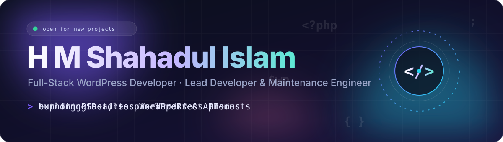

  
  
  
  

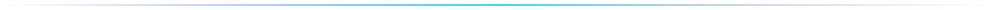


<a href="https://wordpress.org/plugins/easy-php-settings/"></a>

<table>
<tr><td><a href="https://github.com/shahadul878/easy-redirect">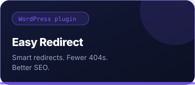</a></td><td><a href="https://github.com/shahadul878/codereyes-mobile-shop">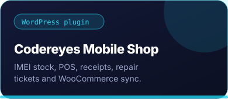</a></td><td><a href="https://github.com/shahadul878/wordpress-inspector-pro">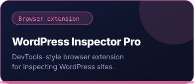</a></td></tr>
<tr><td><a href="https://github.com/shahadul878/sitemind-ai">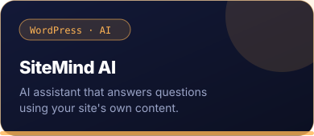</a></td><td><a href="https://github.com/shahadul878/cleanwp">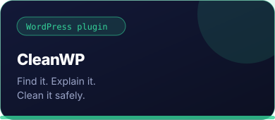</a></td><td><a href="https://github.com/shahadul878/local-addon-laravel">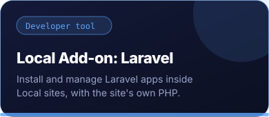</a></td></tr>
</table>


| | |
|---|---|
| 🧩 **Plugins** | Free and pro WordPress plugins, from [Easy PHP Settings](https://wordpress.org/plugins/easy-php-settings/) to tools for shops and developers. |
| 👥 **Team work** | Building ThemeForest themes with a team at a company, as lead developer. |
| 🎨 **Design → Code** | Figma, JPG and complex layouts turned into custom, pixel-perfect, responsive themes. |
| ⚡ **Performance** | Lightweight code structure and smart caching for faster page loads. |
| 🛡️ **Security** | SSL, malware protection and firewalls on client sites. |
| 🔧 **Maintenance** | Keeping a diverse client portfolio running with high uptime and reliability. |

  
  

  

