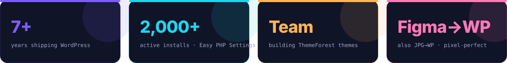

  
  
  
  

## ✦ By the numbers

## ✦ Stack

## ✦ What I ship

| | |
|---|---|
| 🚀 **Products** | A full-featured **Elementor Addons** plugin, built from scratch — **1,000+ downloads** on ThemeForest. |
| 🎨 **Design → Code** | Complex PSD designs turned into custom, pixel-perfect, responsive themes and plugins. |
| ⚡ **Performance** | Lightweight code structure and smart caching for faster page loads. |
| 🛡️ **Security** | SSL, malware protection and firewalls on client sites. |
| 🔧 **Care** | Ongoing maintenance of a diverse client portfolio — high uptime, high reliability. |

## ✦ Activity

  
  

  

